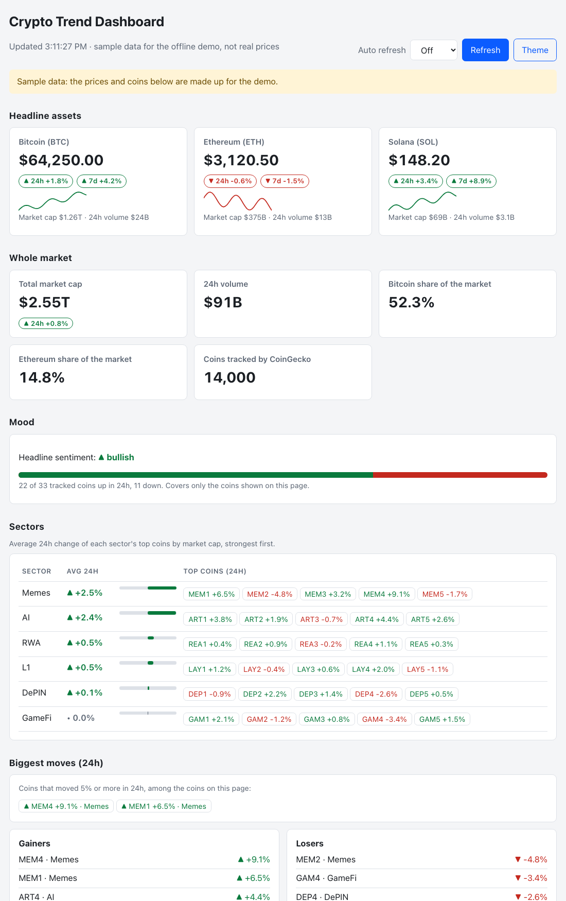

# Crypto Trend Dashboard

A small Flask app that turns CoinGecko's public data into a market snapshot: prices and trends for headline coins, how six sectors moved in the last 24 hours, the biggest gainers and losers, and a paste-ready text or Markdown update. It needs no API key and no JavaScript libraries, and it can keep a local history of its own snapshots.



The screenshot uses the built-in offline sample data (`MOCK_DATA=1`), so its prices and coins are made up for the demo.

## What it does

- **Headline assets:** USD price, 24h and 7d change, market cap, 24h volume and a 7-day sparkline for Bitcoin, Ethereum and Solana (or the coins you choose with `COINS`).
- **Whole market:** total market cap and its 24h change, 24h volume, Bitcoin and Ethereum share of the market, and the number of coins CoinGecko tracks.
- **Sentiment:** **bullish** when more than half of the headline assets rose in 24 hours, otherwise **bearish** (ties are bearish). It describes recent movement; it is not a forecast.
- **Breadth:** how many of the tracked coins (headline plus sector lists, each counted once) rose in 24 hours. It covers only the coins on the page, not the whole market.
- **Sectors:** the top five coins by market cap in each CoinGecko category (GameFi, RWA, Memes, DePIN, AI, Layer 1, or your own list), with each sector's average 24h change, ranked strongest first.
- **Biggest moves:** the top gainers and losers among all tracked coins, plus a **big-moves** list of every coin that moved `ALERT_THRESHOLD` percent (default 5) or more in either direction. Big moves are also added to the update text.
- **Trending:** the coins CoinGecko lists as trending right now. This is search attention, not a recommendation.
- **History:** every real refresh can be saved to a local SQLite file (at most one snapshot every five minutes) and charted as price change over the last 24 hours. Sample data is never saved.
- **Sharing:** copy the update as plain text or Markdown, download a CSV, or post the update to a Slack or Discord webhook from the command line.
- **Background refresh:** with `REFRESH_INTERVAL` set, a background thread keeps the cache warm and saves history snapshots while nobody has the page open.
- **One request per key:** when several visitors ask at the same moment, one request goes to CoinGecko and the rest reuse its answer.
- **Resilience:** responses are cached (120 seconds by default), stale data is served when CoinGecko fails, a rate-limit response pauses further requests instead of hammering the API, and a sector that fails stays empty rather than being filled with unrelated coins.
- **Page:** light and dark themes, optional auto-refresh, no external scripts, fonts or trackers.

An earlier local version mixed CoinGecko and CoinMarketCap data and included a separate BTC price page. This repository is a smaller rewrite: sector membership comes from CoinGecko categories, missing data is not fabricated, and API credentials are not hard-coded.

## Requirements

- Python 3.11+ (CI runs 3.11 and 3.12)
- Internet access for live CoinGecko data

A cold refresh makes one request for the headline coins, one for each sector, one for the whole-market figures and one for trending (nine by default; `OVERVIEW=0` drops the last two). CoinGecko's free API is rate limited and sometimes answers HTTP 429 for one or two sectors; those rows then show as unavailable and the page says why. The cache and the rate-limit pause reduce repeated calls, and a free CoinGecko demo key (`COINGECKO_API_KEY`) raises the limit.

## Run locally

```bash
python3 -m venv .venv
source .venv/bin/activate
python -m pip install -r requirements.txt
python app.py
```

Open [http://localhost:5000](http://localhost:5000). To use another port: `PORT=5057 python app.py`. On macOS, AirPlay Receiver may already use port 5000.

### Static demo (GitHub Pages)

```bash
python scripts/build_demo.py          # writes docs/index.html, docs/summary.json and docs/static/
```

This builds a copy of the page that needs no server, from the offline sample data only (every number is made up, and the page says so). The `docs/` folder in this repository already holds a built copy. To host it, open the repository's Settings, choose Pages, and select the `main` branch and the `/docs` folder. The demo has no history chart and no CSV download; those need the app.

### Offline demo

```bash
MOCK_DATA=1 python app.py
```

This serves fixed sample data with no network requests. The page labels it as sample data.

### Command line

```bash
python cli.py                      # plain text update
python cli.py --format markdown
python cli.py --format json        # the full summary
python cli.py --format csv
python cli.py --mock               # sample data, no network
```

```bash
export DIGEST_WEBHOOK_URL=https://hooks.slack.com/services/...    # keeps the URL out of your shell history
python cli.py --webhook "$DIGEST_WEBHOOK_URL"                       # Slack (plain text)
python cli.py --webhook "$DIGEST_WEBHOOK_URL" --webhook-format discord
```

The webhook URL is a secret: it is never printed, errors never contain it, redirects are not followed, and only `https` URLs are accepted (plain `http` only for `localhost`). Run it from cron for a daily digest.

The exit status is 0 on success, 1 if no data could be fetched and 2 for a bad configuration.

## HTTP endpoints

| Route | Response |
| --- | --- |
| `GET /` | The dashboard page. |
| `GET /api/summary` | JSON with `headline` (price, 1h/24h/7d change, market cap, volume, sparkline), `overview` (whole-market figures), `trending`, `alerts` (the threshold and the coins above it), `prices` (the same data keyed by CoinGecko id), `sentiment`, `breadth`, `sectors` (tickers), `sector_details`, `sector_stats`, `movers`, `post`, `post_markdown`, `errors`, `stale`, `mock` and `generated_at`. Partial data is returned when available; the status is 502 only when nothing could be fetched. |
| `GET /api/post?format=text` or `markdown` | The update as `text/plain` or `text/markdown`. Any other format gives 400. |
| `GET /api/summary.csv` | The headline coins and every sector coin as a CSV download. Names that start with `=`, `+`, `-` or `@` are prefixed so a spreadsheet does not run them as formulas. |
| `GET /api/history?hours=24` | Saved snapshots from the last 1 to 720 hours, or `{"enabled": false}` when history is off. |
| `GET /healthz` | `{"ok": true}`. |

## Configuration

| Variable | Default | Purpose |
| --- | --- | --- |
| `PORT` | `5000` | Port for the Flask development server. |
| `CACHE_TTL` | `120` | Seconds each upstream response is cached. |
| `COINS` | bitcoin, ethereum, solana | Comma-separated CoinGecko ids for the headline cards (1 to 10). |
| `SECTORS_FILE` | built-in six | Path to a JSON object mapping a display name to a CoinGecko category id (1 to 12 entries), for example `{"Stable": "stablecoins"}`. |
| `COINS_PER_SECTOR` | `5` | Coins listed per sector (1 to 20). |
| `FETCH_WORKERS` | `2` | Sector requests in flight at once (1 to 6). |
| `COINGECKO_API_KEY` | unset | A CoinGecko demo key, sent in a request header and never in a URL. |
| `COINGECKO_BASE_URL` | public API | Another API base URL. |
| `OVERVIEW` | `1` | Set to `0` to skip the whole-market and trending requests (two fewer CoinGecko calls per refresh). |
| `ALERT_THRESHOLD` | `5` | Percent move that counts as a big move (0.5 to 100). |
| `REFRESH_INTERVAL` | `0` (off) | Seconds between background refreshes; at least 60 and never shorter than `CACHE_TTL`. Ignored for sample data. With several server workers each one refreshes on its own. |
| `DIGEST_WEBHOOK_URL` | unset | Slack or Discord webhook used by `cli.py` when `--webhook` is not given. |
| `HISTORY` | `1` | Set to `0` to switch off the local history. |
| `HISTORY_DB` | `data/history.sqlite` | Where snapshots are stored. |
| `HISTORY_MIN_INTERVAL` | `300` | Minimum seconds between snapshots (30 or more). |
| `MOCK_DATA` | unset | `1` serves sample data and never records history. |

See `.env.example`. An invalid `COINS` or `SECTORS_FILE` stops the app at start-up with a clear message.

```bash
COINS=bitcoin,ethereum,dogecoin CACHE_TTL=300 PORT=5057 python app.py
```

## Privacy and security

- History is one local file; nothing is sent anywhere except the requests to CoinGecko. The `data/` folder is in `.gitignore`.
- The page ships a strict Content-Security-Policy (no inline script or style, nothing loaded from other sites), and all values from the API are written to the page as text, never as HTML.
- API responses are marked `Cache-Control: no-store`.

## Tests and continuous integration

```bash
python -m pytest -q
```

The 110 tests cover row normalisation, sentiment, breadth, sector statistics and movers, the text, Markdown and CSV output (including spreadsheet-formula safety), cache and stale-data behaviour, the rate-limit pause, request headers, configuration validation, the history store (throttling, pruning, damaged rows), every HTTP route, the security headers, the command line, the background refresher, the webhook digest (against a local test server), the static demo build, the new overview, trending and alert logic, and a check that the page script has valid syntax and never builds HTML from API data. CoinGecko calls are mocked, so the suite needs no key and no network.

GitHub Actions runs a lint step (syntax errors, undefined names, unused imports) and the tests on Python 3.11 and 3.12 for pushes to `main`, pull requests and manual runs.

## Project structure

```text
app.py                  Flask routes, security headers, background refresher wiring
market.py               CoinGecko access, cache, rate-limit pause, sectors, statistics, text/Markdown/CSV
history.py              Local SQLite history of snapshots
cli.py                  Command-line output and the Slack/Discord digest
refresher.py            Background refresh thread
scripts/build_demo.py   Builds the static sample-data demo into docs/
templates/index.html    Page structure
static/style.css        Styles (light and dark)
static/app.js           Rendering, sparklines, history chart, copy and auto-refresh
tests/                  Unit and endpoint tests
.github/workflows/      GitHub Actions workflow
```

## Limitations

- **Rate limits are the main practical limit.** The free CoinGecko API allows only a modest number of requests per minute. Nine requests on a cold refresh is enough to hit it when you reload repeatedly: affected panels show as unavailable, the page says why, and further requests pause until CoinGecko allows them again. `COINGECKO_API_KEY`, a longer `CACHE_TTL`, or `OVERVIEW=0` all help.
- **The webhook digest has only been tested against a local test server,** not against real Slack or Discord, whose payload rules may change. The static demo has been checked in a browser served by a plain file server, but I have not deployed it to GitHub Pages.
- **Verified against the live API:** the headline and sector requests and the response fields used here were checked against CoinGecko's public API once. The demo-key header (`COINGECKO_API_KEY`) and `COINGECKO_BASE_URL` are covered by tests but I have not tried them with a real key.
- CoinGecko category membership changes, and its public API can be slow or rate limited. An empty sector means its request did not produce data; it does not mean the sector has no assets.
- The sentiment rule only says whether most headline assets rose over 24 hours. Breadth and sector averages cover only the coins shown, are unweighted, and say nothing about the rest of the market.
- History starts empty and only grows while the app is used; it has gaps whenever the dashboard is closed. It is a log of what this dashboard saw, not a price database.
- The development server (`python app.py`) is for personal use. For anything shared, run the app behind a production server such as gunicorn.
- This dashboard summarises market data. It is not investment advice or a trading signal.

## License

MIT. See [LICENSE](LICENSE).
